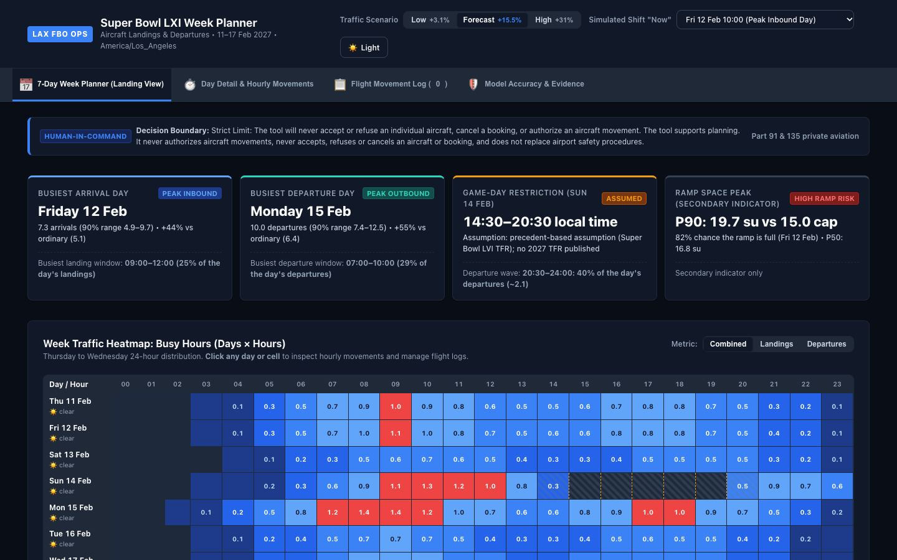
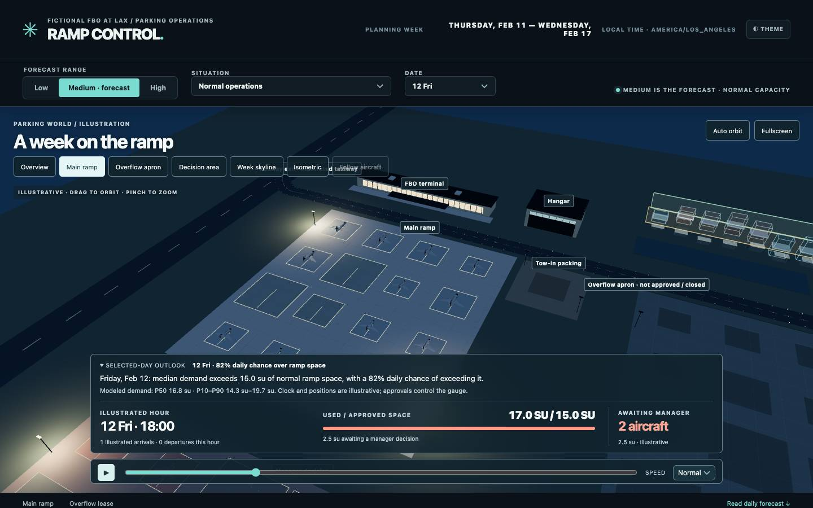
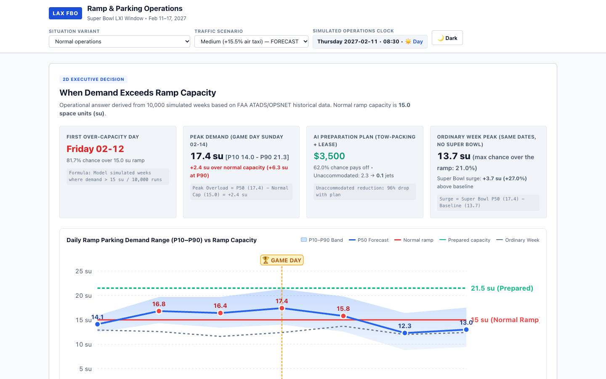
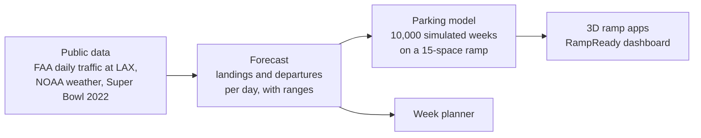

# The Intelligent FBO

**When will the private jets come for the Super Bowl, and will they fit?**

Super Bowl LXI is played in Los Angeles on Sunday 14 February 2027. Private jets fly in for the game, and they land at FBOs: the private terminals at an airport that park, fuel and look after those aircraft. We built planning tools for a fictional FBO at Los Angeles International Airport (LAX) that forecast, for the week of 11 to 17 February 2027:

- **when** the jets land and leave, day by day and hour by hour, and
- **whether they fit** on the FBO's parking ramp, and what to prepare if they don't.

The forecast is built from real public data (FAA airport traffic counts, NOAA weather, the 2022 Super Bowl in LA). The tools only recommend. A person decides every action.

Made during a 2026 hackathon.



## The answer

For the expected scenario (Medium):

| | Result |
|---|---|
| Busiest day for landings | **Friday 12 Feb**: 7.3 landings, +44% on an ordinary Friday, busiest 09:00–12:00 |
| Busiest day for departures | **Monday 15 Feb** (Presidents' Day): 10.0 departures, +55%, busiest 07:00–10:00 |
| Game day | No private flights 14:30–20:30 (assumed, as for the 2022 Super Bowl); 40% of the day's departures leave after 20:30 |
| Parking | Demand is likely to exceed the 15-space ramp from **Friday** (82% chance). The peak is **game day**: 17.4 spaces needed (up to 21.3), 81% chance of running out |
| Suggested preparation | Park aircraft tighter by towing them in (+10% space) and lease 5 spaces of a remote overflow apron for **$3,500**. Aircraft with nowhere to park: **2.3 → 0.1** on average. The lease pays off in 62% of simulated weeks |

Spaces are measured in *space units*: one unit is one light-jet parking position, a midsize jet takes 1.5 and a large jet 2.5.

## Try it

You need Python 3.10 or newer. Nothing to install. Clone the repository, then run one of the apps below and open the address it gives in your browser.

| App | What it shows | Run from the repository root |
|---|---|---|
| **Ramp Control** (main app) | The parking ramp in 3D through the week. The model decides the demand level and which situations apply (the game-day security pause is expected; heavy rain and a 24-hour delay are shown as risks). It shows where every aircraft is, how to manage the flow of aircraft day by day, an impact grid of what-ifs, and the plan a manager approves | `cd ramp_control && python3 -m http.server 8005` → http://127.0.0.1:8005 |
| **Week planner** | For the FBO desk agent: the busiest days and hours of the week, the next 3 hours, the game-day pause, weather. Log your own booked flights and compare them with the forecast | `cd agent_gemini && python3 -m http.server 8004` → http://127.0.0.1:8004 |
| **Parking Operations** (earlier prototype) | The same question as a 2D summary with a forecast chart, plus a 3D airfield with a day/night clock | `cd parking3d_gemini && python3 -m http.server 8006` → http://127.0.0.1:8006 |
| **RampReady dashboard** | For the FBO manager: parking gap per day, scenarios, preparation proposals, and a review step where a named person approves or rejects each one | `python3 dashboard/app.py` → http://127.0.0.1:4180, sign in as the manager demo account |

On Windows, use `py -3` instead of `python3`. The 3D apps load Three.js from a CDN, so they need an internet connection. All dates are in 2027, so the apps simulate the time of day.

<p>


</p>

## How it works



1. **Data** (`sources/`). Daily FAA tower counts at LAX for private flights: general aviation (Part 91) and air taxi (Part 135), 2016–2025 without the 2020–2022 pandemic years. What happened around the 2022 Super Bowl at LAX and five other LA airports, and at eight earlier host cities. The FBO's ramp area from public lease records.
2. **Forecast** (`forecast/`). An ordinary February week is learned from the month and weekday pattern, then scaled for the Super Bowl. The scenarios use what LAX itself measured in 2022: **Low +3.1%** (general aviation), **Medium +15.5%** (air taxi), **High +31%** (twice Medium, a stress test). Presidents' Day and the effect of rain and fog are learned from past data. Every number comes with a 90% range.
3. **Parking** (`parking/`). The forecast drives 10,000 simulated weeks of aircraft arriving, staying and leaving, sized light, midsize or large. That gives the chance the ramp is full each day, and how much a preparation plan helps. Variants: departures delayed 24 hours, the game-day pause, heavy rain.
4. **Apps** (`ramp_control/`, `agent_gemini/`, `parking3d_gemini/`, `dashboard/`). They read only the team's exported data files (`site_kit/`, `parking_kit/`) and invent no numbers.

## Can you trust it?

- **Tested on days it hadn't seen.** On every week of 2025, using only earlier data, the average daily error was **14.9%**, better than four simple methods (16.6%, 17.8%, 18.4%, 21.5%). **88%** of days fell inside the 90% range. On January–September 2026, kept aside until the end: 98.5%.
- **The Super Bowl effect is uncertain.** Across eight earlier host cities, private traffic changed from −32% to +81%. That is why there are three scenarios.
- **Assumptions are labelled.** The biggest ones: the FBO handles 10% of LAX private traffic; the hour-of-day curve is a placeholder; the 15-space ramp is an estimate, not a stand count; no 2027 flight restriction has been published yet. Every app marks which numbers are measured, estimated or assumed.
- **Tests** check that every number in the apps matches the models' outputs, that the models reproduce their reported accuracy, and that the apps work in a browser:

  ```sh
  python3 -m pytest -q    # about 220 tests, 40 s; the app tests also use Node and Chrome when installed
  ```

## Humans in command, and privacy

**What decision should the AI never be allowed to make?** Whether a specific aircraft may land, park or leave. The tools never accept or refuse an aircraft, cancel a booking, authorize a movement or commit money. They forecast and propose; a named person approves or rejects each proposal.

There is no passenger, crew or owner data anywhere. A logged flight is a time, a size and an optional tail number, and it stays in your browser.

## What's in the repository

New here? Read in this order: this page, then `data_sources.md` (every source), `assumptions.csv` (every assumption), and the README in each folder below.

| Folder | What it is | Start with |
|---|---|---|
| `sources/` | Step 1, the data: public FAA, NOAA and airport records, the scripts that clean them, the Super Bowl 2022 analysis and the ramp-size research | `sources/docs/`, `sources/assumptions.csv` |
| `forecast/main_forecast/` | Step 2, the forecast the apps use: daily landings and departures with ranges, the accuracy tests on 2025 and 2026 | `README.md`, `PROVISIONAL_ASSUMPTIONS.md` |
| `forecast/category_forecast/` | A second forecast split by flight type (Part 91 private, Part 135 charter) with the measured effect of rain and fog | `README.md` |
| `parking/` | Step 3, the parking model: 10,000 simulated weeks, the chance the ramp is full each day, the preparation plan and the arrival offers | `PARKING_ASSUMPTIONS.md`, `parking_optimizer.py` |
| `parking_kit/`, `site_kit/` | Step 4: turn the model outputs into the single data file each app reads (`parking_data.json`, `agent_data.json`) | `export_parking_data.py` |
| `ramp_control/` | The main app (3D) | open it as shown above |
| `agent_gemini/`, `parking3d_gemini/` | Other apps: the week planner and an earlier 3D prototype | open them as shown above |
| `dashboard/` | The manager dashboard, integration checks and the app and data tests | `README.md` |
| `docs/` | Screenshots | |

Several apps were built with AI coding assistants (Claude, Codex, Gemini), as their folder names say, from briefs and data the team wrote.

## Limits

This is a hackathon project, not an operational system. The FBO is fictional, its traffic share and ramp size are estimates, and the hourly pattern is a placeholder until real FBO data is available. The forecasts describe completed airport operations, not bookings. Do not use them to make real aviation decisions.

## License

[MIT](LICENSE) for the team's code, documentation and derived data. The third-party documents in `sources/data/raw/` keep their owners' terms.
